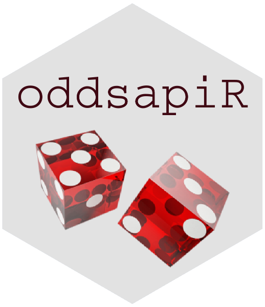
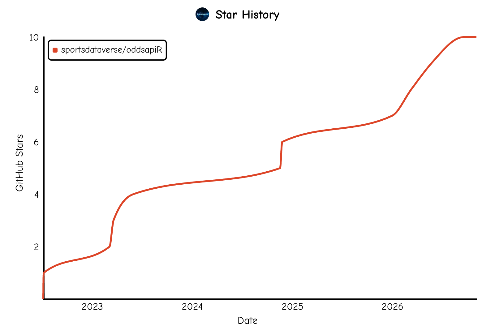

# **oddsapiR** <a href='https://oddsapiR.sportsdataverse.org/'></a>

<!-- badges: start -->

[](https://CRAN.R-project.org/package=oddsapiR)
[](https://CRAN.R-project.org/package=oddsapiR)
[](https://sportsdataverse.r-universe.dev/oddsapiR)
[](https://github.com/sportsdataverse/oddsapiR/)
[](https://github.com/sportsdataverse/oddsapiR/actions/workflows/R-CMD-check.yaml)
[](https://app.codecov.io/gh/sportsdataverse/oddsapiR)
[](https://github.com/sportsdataverse/oddsapiR/actions/workflows/pkgdown.yaml)
[](https://lifecycle.r-lib.org/articles/stages.html#stable)
[](https://github.com/sportsdataverse/oddsapiR/blob/main/LICENSE.md)
[](https://github.com/sportsdataverse/oddsapiR/graphs/contributors)
[](https://github.com/sportsdataverse/oddsapiR/stargazers)
[](https://x.com/SportsDataverse)
<!-- badges: end -->

```{r setup, include = FALSE}
knitr::opts_chunk$set(
  collapse = TRUE,
  comment = "#>",
  fig.path = "man/figures/README-",
  out.width = "100%"
)
```

[**`oddsapiR`**](https://oddsapiR.sportsdataverse.org/) is an R package for accessing live and historical sports betting odds, scores, events, and participants from [**The Odds API**](https://the-odds-api.com/) — spanning dozens of sports and 60+ bookmakers worldwide. Every endpoint returns a clean, tidy `data.frame`/`tibble` ready for analysis, built on a single `httr2`-based request layer with automatic API-key handling and usage-quota tracking.

Part of the [SportsDataverse](https://sportsdataverse.org/) family of R & Python packages for sports analytics. To access the API, get a free API key at <https://the-odds-api.com>.

Data freshness and pipeline status for every SportsDataverse dataset: [sportsdataverse.org/status](https://sportsdataverse.org/status).

## **Installation**

You can install the CRAN version of [**`oddsapiR`**](https://CRAN.R-project.org/package=oddsapiR) with:

```r
install.packages("oddsapiR")
```

You can install the latest build from [R-universe](https://sportsdataverse.r-universe.dev/oddsapiR) with:

```r
install.packages("oddsapiR", repos = c("https://sportsdataverse.r-universe.dev", getOption("repos")))
```

You can install the development version of [**`oddsapiR`**](https://github.com/sportsdataverse/oddsapiR/) from GitHub with:

```r
if (!requireNamespace("pak", quietly = TRUE)) install.packages("pak")
pak::pak("sportsdataverse/oddsapiR")
# or: remotes::install_github("sportsdataverse/oddsapiR")
```

```r
# or clone and install locally
git clone https://github.com/sportsdataverse/oddsapiR
cd oddsapiR
Rscript -e "pak::local_install()"  # or: Rscript -e "devtools::install()"
```

#### **Odds API Keys**

The [Odds API](https://the-odds-api.com) requires an API key, here's a quick run-down:

* Using the key: You can save the key for consistent usage by adding `ODDS_API_KEY=XXXX-YOUR-API-KEY-HERE-XXXXX` to your .Renviron file (easily accessed via [**`usethis::edit_r_environ()`**](https://usethis.r-lib.org/reference/edit.html)). Run [**`usethis::edit_r_environ()`**](https://usethis.r-lib.org/reference/edit.html), a new script will pop open named `.Renviron`, **THEN** paste the following in the new script that pops up (with**out** quotations)
```r
ODDS_API_KEY = XXXX-YOUR-API-KEY-HERE-XXXXX
```
Save the script and **restart your RStudio session**, by clicking `Session` (in between `Plots` and `Build`) and click `Restart R` (there also exists the shortcut `Ctrl + Shift + F10` to restart your session). If set correctly, from then on you should be able to use any of the functions without any other changes.

* For less consistent usage: At the beginning of every session or within an R environment, save your API key as the environment variable `ODDS_API_KEY` (with quotations) using a command like the following.

```{r setenv}
Sys.setenv(ODDS_API_KEY = "XXXX-YOUR-API-KEY-HERE-XXXXX")
```


## **Quick start**

With `ODDS_API_KEY` set (see above):

```r
library(oddsapiR)

# sports that are in season, with the sport_key each endpoint takes
toa_sports(all_sports = FALSE)

# current NFL spreads from US bookmakers, in American odds
toa_sports_odds(sport_key = "americanfootball_nfl", regions = "us",
                markets = "spreads", odds_format = "american")

# NBA scores, including games completed in the last 3 days
toa_sports_scores(sport_key = "basketball_nba", days_from = 3)

# requests used and remaining after the last call
toa_quota()
```

## **Documentation**

For more information on the package and function reference, please see
the [**`oddsapiR`** documentation website](https://oddsapiR.sportsdataverse.org).

There is also a printable [**`oddsapiR` cheat sheet (PDF)**](https://sportsdataverse.org/cheatsheets/oddsapiR.pdf), one of [a set covering every SportsDataverse package](https://sportsdataverse.org/cheatsheets).

- [Package site](https://oddsapiR.sportsdataverse.org/)
- [Function reference](https://oddsapiR.sportsdataverse.org/reference/index.html)
- Vignettes:
  - [Getting started with oddsapiR](https://oddsapiR.sportsdataverse.org/articles/oddsapiR.html)
  - [Building a sports-odds pipeline with oddsapiR](https://oddsapiR.sportsdataverse.org/articles/building-an-odds-pipeline.html)
- [News and release notes](https://oddsapiR.sportsdataverse.org/news/index.html)

## **Breaking Changes**

[**Full News on
Releases**](https://oddsapiR.sportsdataverse.org/news/index.html)

## **Companion packages**

`oddsapiR` returns odds keyed by team names and start times; these packages supply the games, results and visuals to pair them with:

* [**`cfbfastR`**](https://cfbfastR.sportsdataverse.org/), [**`hoopR`**](https://hoopR.sportsdataverse.org/), [**`wehoop`**](https://wehoop.sportsdataverse.org/), [**`fastRhockey`**](https://fastRhockey.sportsdataverse.org/) and [**`baseballr`**](https://billpetti.github.io/baseballr/) — schedules, scores and play-by-play to join odds onto.
* [**`sdvplotR`**](https://sdvplotR.sportsdataverse.org/) — team logos, colors and `gt` tables for every SportsDataverse league. r-universe only.

## **The SportsDataverse**

[**`oddsapiR`**](https://oddsapiR.sportsdataverse.org/) is part of the [SportsDataverse](https://sportsdataverse.org/), a set of
open-source packages for sports data.

| Package | Sport / Scope |
|---|---|
| [**cfbfastR**](https://cfbfastR.sportsdataverse.org/) | College football |
| [**hoopR**](https://hoopR.sportsdataverse.org/) | Men's basketball (NBA and NCAA) |
| [**wehoop**](https://wehoop.sportsdataverse.org/) | Women's basketball (WNBA and NCAA) |
| [**fastRhockey**](https://fastRhockey.sportsdataverse.org/) | Hockey (NHL and PWHL) |
| [**baseballr**](https://billpetti.github.io/baseballr/) | Baseball (MLB, MiLB, NCAA) |
| [**softballR**](https://github.com/sportsdataverse/softballR) | College softball |
| [**oddsapiR**](https://oddsapiR.sportsdataverse.org/) | Sports betting odds |
| [**recruitR**](https://recruitR.sportsdataverse.org/) | College football recruiting |
| [**usfootballR**](https://usfootballR.sportsdataverse.org/) | US soccer |
| [**cfbseedR**](https://cfbseedR.sportsdataverse.org/) · [**cfb4th**](https://cfb4th.sportsdataverse.org/) | CFB playoff simulation · fourth-down decisions |
| [**cfbplotR**](https://cfbplotR.sportsdataverse.org/) · [**sdvplotR**](https://sdvplotR.sportsdataverse.org/) · [**sportyR**](https://sportyR.sportsdataverse.org/) | Logos, colors, tables · playing surfaces |
| [**sportsdataverse-R**](https://r.sportsdataverse.org/) | Umbrella R metapackage |
| [**sportsdataverse-py**](https://py.sportsdataverse.org/) · [**sportsdataverse.js**](https://js.sportsdataverse.org/) | Python and Node.js |

See the full ecosystem at [sportsdataverse.org](https://sportsdataverse.org/).

## **Follow the [SportsDataverse](https://x.com/SportsDataverse) on X and star this repo**

[](https://x.com/SportsDataverse)

[](https://github.com/sportsdataverse/oddsapiR)

<a href="https://github.com/sportsdataverse/oddsapiR/stargazers">
  <picture>
    <source media="(prefers-color-scheme: dark)" srcset="https://raw.githubusercontent.com/sportsdataverse/oddsapiR/star-history/star-history-dark.svg">
    
  </picture>
</a>

## **Our Authors**

-   [Saiem Gilani](https://x.com/saiemgilani)
<a href="https://x.com/saiemgilani" target="blank"></a>
<a href="https://github.com/saiemgilani" target="blank"></a>


<!-- cheatsheet-section -->
## **Cheat sheet**

A printable one-page reference for **`oddsapiR`** — the function families, the loaders, and what each one returns.

📄 **[Download the oddsapiR cheat sheet (PDF)](https://sportsdataverse.org/cheatsheets/oddsapiR.pdf)**

Free to download, print and hand out; light and dark, US Letter landscape.
Every SportsDataverse package has one — browse them all at
**[sportsdataverse.org/cheatsheets](https://sportsdataverse.org/cheatsheets)**.

## **Code of Conduct**

Please note that the oddsapiR project is released with a [Contributor Code of Conduct](https://oddsapiR.sportsdataverse.org/CODE_OF_CONDUCT.html).
By contributing to this project, you agree to abide by its terms.

## **Citations**

To cite the [**`oddsapiR`**](https://oddsapiR.sportsdataverse.org) R package
in publications, use:

BibTeX Citation

```bibtex
@misc{gilani_oddsapiR,
  author = {Gilani, Saiem},
  title = {oddsapiR: The SportsDataverse's R Package for The Odds API.},
  url = {https://oddsapiR.sportsdataverse.org},
  doi = {10.32614/CRAN.package.oddsapiR},
  year = {2026}
}
```

## **License**

[MIT](https://github.com/sportsdataverse/oddsapiR/blob/main/LICENSE.md) © oddsapiR authors. See [LICENSE.md](https://github.com/sportsdataverse/oddsapiR/blob/main/LICENSE.md).
